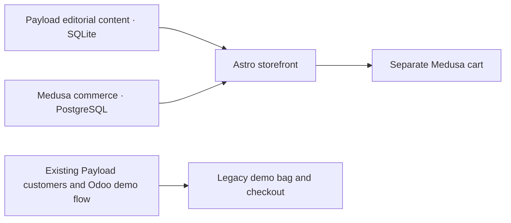

# Local architecture

## Commerce transition (28 October 2026)

The npm workspace now also contains Medusa 2.22.1 at `apps/commerce`. Medusa owns commerce for products explicitly linked by Payload's optional `medusaProductId`; Payload owns editorial content and Astro composes the final experience. Payload continues using its existing SQLite database and uploads. Medusa has a separate PostgreSQL database. This intentional SQLite/PostgreSQL split preserves existing data rather than migrating the CMS unnecessarily.

India/INR commerce is accessible at http://localhost:9000, with Medusa Admin at `/app`. The separate commerce bag at `/commerce/cart` stores an anonymous Medusa cart identity in an HTTP-only cookie and uses official SDK operations through Astro's same-origin API. It does not place orders or collect payments. Existing numeric Odoo variant selections, Payload customer sessions, historical orders, and the legacy demo checkout remain separate. No automatic account/cart migration or new ERP dependency is introduced.

Use `npm run dev:all` for the complete local environment; the existing `npm run dev` CMS/Astro workflow remains. See [commerce](commerce.md), [development](development.md), [integration boundaries](integrations.md), [tooling](medusa-tooling.md), and [audit](medusa-implementation.md). The source-grounded transition notes above supersede older deferred-functionality descriptions below.

Payload in `apps/cms` owns content, administrator access, drafts, SQLite and uploads. The Next.js application hosts its admin and REST routes. Astro in `apps/storefront` renders the storefront per request through the standalone Node adapter. It fetches published content through REST without administrator credentials; it never accesses SQLite directly.

## Rendering and UI

Narrative content, navigation links and catalogue modules are static Astro HTML. React islands supply shadcn/Radix sheets, gallery dialogs, support accordions, purchase controls, Bag views and checkout fields. Controls that need a common dialog context remain in one island. Semantic CSS roles centrally style owned shadcn source. Its generated utility imports resolve to `lib/utils`; upstream control glyphs use the local Keyline adapter. Fonts are bundled locally. Static story reading remains available without JavaScript; Bag editing requires it.

The server writes an approved `data-theme` on the document root. Shared routes use neutral; product pages resolve an approved theme ID against the pinned palette snapshot. Unknown theme IDs or mismatched pinned hues log an editorial error and resolve to neutral. CSS defines complete functional colour pairs; body-mounted portals inherit them. Normal full-document navigation and browser history preserve server-selected themes. ResizeObserver measures sticky chrome so anchor offsets also adapt to text wrapping.

## Content and review objects

Products retain their original IDs, gallery, description, specifications, feature items, price/currency and availability. Optional additions cover descriptor, editorial order, broad/paired feature size, theme ID, story chapters and explicitly selected related objects. Price is nullable, purchase eligibility is separate, and `reviewOnly` independently prevents purchasing. Existing records default to their previous eligibility. Only published stories are publicly fetched. Prices are integer paise in INR.

The four review concepts are ordinary published CMS records marked `demo` and `reviewOnly`. Their names, draft copy and missing facts are explicit. The homepage displays review concepts and non-demo published products; legacy fictional demo objects remain discoverable in Objects. Related objects are never inferred from arbitrary record order. An idempotent seed and media attachment command preserve existing slugs and galleries. Labelled local fallback art is limited to known review slugs and yields to supplied non-placeholder imagery. Broad homepage references have separate wide and mobile compositions.

Media adds provenance, placeholder flags and mobile focal points alongside Payload's built-in desktop focal coordinates. Generated review assets are identified as illustrative concepts, with provenance and licences under `docs/design` and `docs/licences`. No image represents a final product specification.

## Bag and checkout

`lib/bag.ts` owns the single browser state boundary across islands. `studio-cart-v1` continues to store only `{ id, quantity }`. Initialization validates IDs and quantities, removes duplicates and caps selections. Subscribers update header counts immediately; storage events synchronize tabs. Storage failure retains current-page selections and explains their limited lifetime.

POST `/api/cart` validates at most 100 selections and quantities 1–99, then resolves current published details. Shared purchase policy excludes unknown prices, unavailable objects, disabled purchase eligibility and review concepts. Removed or unpublished IDs remain explanatory lines and cannot contribute to subtotals. Zero is an explicit supplied price, not a fallback for unknowns. Price and availability refresh before summaries display. Request cancellation prevents stale responses; errors retain selections and offer Retry. Removal offers Undo.

The existing checkout is a local Odoo demonstration using Payload customers and saved delivery details/orders. Its configurator reads numeric Odoo variants; the legacy bag resolves current Odoo prices and stock. It does not collect money. See [the existing Odoo workflow](odoo-local-workflow.md) for its reservation and simulated-payment semantics. Live Odoo verification requires private credentials, which are not supplied by the Medusa setup. Medusa-linked products cannot enter this legacy checkout; their independent cart currently stops before checkout.

## Local persistence and upgrades

Back up database and uploads together while services are stopped. `npm run setup:review` stages additive fields before relaxing the prior SQLite required-price constraint, then creates missing review records and attaches media. It is an explicit local development upgrade, not a replacement for Payload's supported production migration workflow. Payload type generation and the configured TypeScript admin import map are checked into source. Environment files and local data stay outside Git.

Catalogue requests currently cap at 100 objects. Add pagination before expanding beyond that. Actual product facts, approved palettes and confirmed policies are still editorial work; the local review cannot establish readiness for live commerce.
